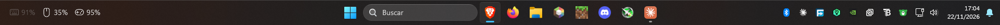
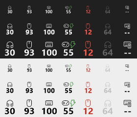

# BatteryHub

Batería de tus periféricos inalámbricos (auriculares, mouse, teclado, joysticks) en la barra de
tareas de Windows, sin G Hub, Synapse, iCUE ni SteelSeries GG.

## ⬇️ Descargar

**[Última versión → BatteryHub.exe](https://github.com/Maurito2004/BatteryHub/releases/latest)** (sección
*Releases* a la derecha del repo). Un solo archivo: descargalo, ejecutalo y activá *Configuración… →
General → Iniciar con Windows*. No necesita instalación ni permisos de administrador.
Desde la 1.2.0 se **actualiza sola**: abajo de todo del menú aparece *"Actualizar a la versión X"* cuando
hay una nueva (o *"App actualizada"* si ya tenés la última).

> **Compatibilidad:** probado solo en **Windows 11** (build 26300, barra con apps centradas).
> En **Windows 10** todavía no se probó: el código usa APIs disponibles desde Windows 10 y el
> widget de la barra busca la misma estructura (`Shell_TrayWnd` / `TrayNotifyWnd`), pero no está
> verificado. Si algo falla ahí, el modo "área de notificación" del menú es la alternativa.

- **Ventana de Configuración** (clic en la barra → *Configuración…*): tus dispositivos con su barra de carga,
  renombrar y ordenar, dónde se muestran, tema, intervalo, umbral de batería baja con un deslizador,
  modo juego, inicio con Windows y actualizaciones. Se dibuja con Direct2D y solo existe mientras está abierta.
- **C++17 + Win32 + GDI+**, sin runtime, sin servicio, sin admin. Un solo `.exe` portable (~330 KB).
- ~3 MB de memoria privada en reposo.
- **En la barra de tareas** (por defecto): `[ícono] XX%` por dispositivo, al lado izquierdo del reloj,
  adaptado al tema claro/oscuro. Alternativa: un ícono por dispositivo en el área de notificación.



Íconos del modo "área de notificación" (barra oscura arriba, clara abajo; 16/24/32 px):



*Rojo = batería baja, rayo verde = cargando, gris = último valor conocido de un dispositivo
desconectado o en reposo.*

## Compilar

```bat
build.bat            :: detecta cl.exe (MSVC) o g++/clang++ (MinGW / LLVM-MinGW)
build.bat msvc       :: forzar MSVC (desde "Developer Command Prompt")
build.bat mingw      :: forzar MinGW
```

o con CMake:

```bat
cmake -S . -B build-cmake -G Ninja -DCMAKE_BUILD_TYPE=MinSizeRel
cmake --build build-cmake
```

Sin compilador: `winget install MartinStorsjo.LLVM-MinGW.UCRT` (por usuario, sin admin). `build.bat` lo
encuentra aunque no esté en el `PATH`.

Librerías: `hid`, `setupapi`, `cfgmgr32`, `bluetoothapis`, `gdiplus`, `d2d1`, `dwrite` (+ las básicas de Win32). XInput se
carga en tiempo de ejecución (`xinput1_4.dll`), así que el exe arranca aunque falte.

## Uso

| Comando | Qué hace |
|---|---|
| `BatteryHub.exe` | Corre en el área de notificación |
| `BatteryHub.exe --dump` | Lista todas las colecciones HID (VID, PID, UsagePage, Usage, interfaz, tamaños de reporte), dispositivos Bluetooth/BLE y slots XInput, con el porcentaje leído o el error |
| `BatteryHub.exe --dump > dump.txt` | Igual, guardado en UTF-8 |
| `BatteryHub.exe --preview out.png` | (desarrollo) renderiza todos los estados de ícono |
| `BatteryHub.exe --probe VID PID PAGE [bytes hex]` | (desarrollo) abre esa colección HID, opcionalmente escribe un reporte de salida y muestra todo lo que llega durante 2 s. Ej.: `--probe 3537 10A9 FFF0 0F 0B` |

El ejecutable listo para usar está en [Releases](https://github.com/Maurito2004/BatteryHub/releases/latest)
(y también en [`release/BatteryHub.exe`](release/BatteryHub.exe)): no hace falta compilar.

**Publicar una versión nueva:** subí el número en `assets/resource.h`, escribí las notas en
`docs/release-notes/vX.Y.Z.md` y empujá la etiqueta (`git tag -a vX.Y.Z -m "..." && git push origin
vX.Y.Z`). GitHub Actions ([`.github/workflows/release.yml`](.github/workflows/release.yml)) compila en
Windows y publica el Release con el `.exe` y un `.zip` portable.

**Reordenar:** mantené apretado un dispositivo del widget y arrastralo a otro lugar; el orden se
guarda (`HKCU\Software\BatteryHub\Order`) y también se usa en el menú y en el modo tray.

**Menú oscuro / claro:** *Configuración → Tema del menú* (igual que Windows, oscuro o claro), con íconos
de Segoe Fluent en cada opción.

**Clic en el widget de la barra (o en cualquier ícono del tray):** lista de dispositivos con tipo, alias, porcentaje,
conexión (BT / 2.4 GHz / Cable) y estado de carga — clic en uno para renombrarlo —, *Actualizar ahora*,
*Configuración* (mostrar en barra de tareas / área de notificación, intervalo, umbral de batería baja,
ocultar en reposo, ocultar durante juegos, ocultar con el navegador a pantalla completa, iniciar con
Windows) y *Salir*.

**Conectado, en reposo y desconectado:**
- **Conectado:** porcentaje en vivo (rayo verde si está cargando o enchufado con carga completa).
- **En reposo:** el dispositivo o su dongle siguen presentes pero no responden (un mouse o teclado
  dormido): se muestra el último valor, atenuado. El último valor se guarda, así que aparece incluso
  tras reiniciar la PC.
- **Desconectado:** desapareció de Windows (mando apagado, cable o dongle quitados, Bluetooth fuera de
  alcance): se quita de la barra hasta que vuelva.

**Modo juego** (activado por defecto): cuando hay un juego o app a pantalla completa adelante — pantalla
completa exclusiva (D3D), las que Windows marca como "ocupado", o una ventana sin bordes que cubre todo el
monitor — BatteryHub se oculta y **deja de consultar los dispositivos** (cero tráfico HID mientras jugás).
Al cerrar el juego vuelve solo y actualiza enseguida. Espera 2 s de confirmación para no parpadear con
Alt+Tab. Los **navegadores a pantalla completa** (Brave, Chrome, Edge, Firefox, Opera, Vivaldi, Arc, Zen,
LibreWolf) **no** lo ocultan por defecto, porque suele ser un video; se puede cambiar con *Configuración →
Ocultar también con el navegador a pantalla completa*.

**Widget en la barra:** es una ventana hija de la barra de tareas (`Shell_TrayWnd`). Por defecto va en
el extremo izquierdo (con las apps centradas de Windows 11 ese lado siempre está libre); también puede ir
junto al reloj. Si el lado elegido chocaría con el botón Inicio o con los botones de apps, se pasa solo
al otro lado. Se reubica cada segundo y se vuelve a crear si Explorer se reinicia. Con la barra vertical, o si la barra no tiene esa estructura,
pasa automáticamente al modo de íconos del tray.

**Refresco:** cada 60 s (configurable de 30 s a 10 min), y además a los 2 s de un `WM_DEVICECHANGE`
(USB/HID/Bluetooth, con debounce) y a los 6 s de volver de suspensión (`WM_POWERBROADCAST`). La lectura
corre en un hilo aparte: la UI nunca se bloquea esperando a un dispositivo dormido.

**Configuración:** `HKCU\Software\BatteryHub` (alias en `...\Aliases`). Inicio automático:
`HKCU\Software\Microsoft\Windows\CurrentVersion\Run\BatteryHub`. Nada se escribe junto al exe.

## Arquitectura

```
src/
  main.cpp                    argumentos (--dump, --preview, --help)
  core/
    device.h/.cpp             BatteryReading: id, nombre, tipo, conexión, %, carga, online
    provider.h                interfaz Provider::Poll()
    device_manager.*          junta providers, deduplica por id, conserva el último % conocido
    hid_util.*                enumeración HID (SetupAPI + hid.dll), E/S overlapped con timeout
    settings.*                registro HKCU, autoarranque, tema de la barra
    log.*                     salida de consola para --dump (app GUI adjunta a la consola padre)
  providers/
    bluetooth_pnp_provider    propiedad PnP de batería {104EA319-…},2 (la que muestra Configuración)
    ble_gatt_provider         GATT Battery Service 0x180F / Battery Level 0x2A19
    xinput_provider           XInputGetBatteryInformation (Xbox)
    hid_provider              enumera HID una vez y despacha según la tabla kHidModels
    hid_models.cpp            ← TABLA DE DISPOSITIVOS: agregá VID/PID acá
    logitech_hidpp.cpp        HID++ 2.0 (0x1004, 0x1000, 0x1001, 0x1F20) vía receptor o directo
    razer.cpp                 reporte feature de 90 bytes, clase 0x07
    headsets.cpp              SteelSeries Arctis, Corsair VOID/HS, HyperX Cloud
    playstation.cpp           DualShock 4 / DualSense (byte de estado del reporte de entrada)
    compx.cpp                 mouse ATK/VXE/VGN (Compx y Nordic 54), teclados AULA
    gamesir.cpp               mandos GameSir por dongle 2.4 GHz
  ui/
    icon_renderer.*           GDI+: glifo Segoe Fluent Icons / MDL2 + dígitos → HICON con alfa
    taskbar_widget.*          ventana en capas hija de la barra de tareas: "[ícono] XX%" junto al reloj
    tray.*                    un Shell_NotifyIcon por dispositivo (uID estable), re-alta tras reiniciar Explorer
    app.*                     ventana oculta, timers, notificaciones, menú, diálogo de alias
assets/                       app.rc, manifest (PerMonitorV2, asInvoker), ícono, resource.h
```

Bluetooth: los dos providers identifican el dispositivo por su `ContainerId` (`bt:{guid}`), así que un
mismo dispositivo visto por PnP y por GATT aparece una sola vez.

## Estado de cada protocolo

| Dispositivo | Dongle / conexión | Estado |
|---|---|---|
| Mouse ATK / VXE / VGN (Compx) | 2.4 GHz, `373B:*` colección `FF02` de 17 bytes | **Verificado** (ATK, dongle `373B:10C9`: % + voltaje + carga) |
| Teclado AULA F75 / F75 Pro | 2.4 GHz, `3554:FA09` colección `FF02` de 20 bytes (`col01`) | **Verificado** (91 %). Dormido no responde → se muestra atenuado |
| AULA F68 / F87 / F99 | 2.4 GHz, `3554:FA08/FA0A/FA10/FA11` | Mismo protocolo, sin verificar |
| ATK 8K (Nordic nRF54, A9 Pro Max) | 2.4 GHz, `373B:*` colección `FF05/0001` | Sin verificar |
| GameSir Cyclone 2 por cable | USB, `3537:1053` colección `FFF0/0040` | **Verificado** (reporte `0x12`: byte 36 = %, byte 35 = cargando; 62→65 % cargando) |
| GameSir Cyclone 2 por dongle / G7 Pro 8K | 2.4 GHz, `3537:100B` / `10C6`… colección `FFF0/0040` | Mismo protocolo, sin verificar por dongle |
| GameSir G7 Pro Xbox (edición Wuchang) | 2.4 GHz, `3537:10A9` colección `FFF0/0040` | **Se detecta, sin batería**: se muestra como mando conectado con `--`. No responde a `0F 0B`, `0F 09` ni `0F F2 00`, y Windows.Gaming.Input solo devuelve un valor de relleno (1000/1000 mWh). GameSir Nexus lee la batería por un canal sin documentar |
| GameSir Nova 2 Lite | 2.4 GHz, `3537:*` colección `FF7A` | Sin verificar (byte 19, `0xFF` = cargando) |
| DualSense (PS5) | Bluetooth (`054C:0CE6`, reporte `0x31`, byte 54) | **Verificado** (95–100 %, descargando) |
| DualSense (PS5) por cable | USB (`054C:0CE6` MI_03, reporte `0x01`, byte 53) | **Verificado** (100 %, carga completa, con rayo) |
| DualSense Edge / DualShock 4 | USB o Bluetooth | Mismo lector, sin verificar |

El DualSense se identifica por su MAC (número de serie por Bluetooth, reporte de emparejamiento `0x09`
por USB), así que al enchufarlo o desenchufarlo sigue siendo **el mismo dispositivo**, no aparece dos veces.
El rayo verde se muestra mientras carga y también cuando está enchufado con la carga completa.

Los mandos GameSir en modo XInput le dicen a Windows que están "por cable" y no dan nivel: por eso XInput
los ignora y se leen por su colección de fabricante (la que usa GameSir Connect). Un mando GameSir que no
informa batería igual aparece, atenuado y con `--`, para que sepas que está conectado. Con más de un mando
conectado, cada uno lleva un número (1, 2, 3...) junto al ícono y en el tooltip; cada dongle tiene su
propia identidad, así que dos mandos iguales no se mezclan.

| Provider | Estado |
|---|---|
| Bluetooth PnP (auriculares HFP, BLE mice/teclados, earbuds) | API estándar de Windows. Probado sin dispositivos BT en esta máquina. |
| BLE GATT 0x180F | API estándar; lee el valor cacheado por el stack (no despierta el dispositivo). |
| XInput | API estándar. Por cable XInput no informa nivel → se muestra `--` con rayo. |
| PlayStation DS4 / DualSense | Offsets del driver `hid-playstation` de Linux. **Sin verificar en hardware.** |
| Logitech HID++ 2.0 | Protocolo documentado (Solaar). **Sin verificar en hardware.** |
| Razer | Protocolo OpenRazer. **Sin verificar en hardware.** |
| SteelSeries / Corsair / HyperX | Layouts de HeadsetControl. **Sin verificar en hardware.** |

Cada entrada de la tabla tiene `verified = false` hasta confirmarla con el dispositivo real. `--dump`
imprime las respuestas crudas en hex para depurar.

**Créditos de ingeniería inversa:** ATK/VXE — renanleonel/windows-taskbar-battery (PR #5),
Fan4Metal/ATK_tray, Lkig/ATK-A9-Battery · AULA — Makkksx/AulaMonitor, DillanCidral/Joule (PR #58) ·
GameSir — HeyOkay/HaloBattery (PR #390), pedrosegato/gamesir-reverse-engineering,
AJAY0406/Gamesir-Nova-2-Lite-Battery-Detection · Logitech — Solaar · Razer — OpenRazer · auriculares —
HeadsetControl · PlayStation — driver `hid-playstation` de Linux.

## Agregar un dispositivo nuevo

1. Ejecutá `BatteryHub.exe --dump > dump.txt` con el dispositivo conectado y encendido.
2. Buscá su línea `VID=… PID=… UsagePage=… Usage=… MI=…`. La colección de control suele ser la de
   UsagePage de fabricante (`FFxx`) con tamaño de salida o feature distinto de 0.
3. Si habla un protocolo existente, agregá **una línea** a `kHidModels` en
   [src/providers/hid_models.cpp](src/providers/hid_models.cpp):
   ```cpp
   {0x046D, 0xC548, 0xFF00, 0x0002, -1, K::Unknown, C::Wireless24, nullptr, ReadLogitechHidpp, false},
   ```
4. Si es un protocolo nuevo, escribí un lector con la firma
   `bool Read…(HidDevice&, const HidModel&, std::vector<BatteryReading>&)` (ver `headsets.cpp` como
   ejemplo de pedido/respuesta), declaralo en `hid_models.h` y referencialo desde la tabla.
5. Cuando lo confirmes con el dispositivo real, poné `verified = true`.

## Limitaciones conocidas

- **Modo tray:** el área de notificación solo admite íconos cuadrados (16–32 px), así que ahí el glifo va
  arriba y el número abajo. El modo por defecto (widget en la barra) no tiene esa limitación.
- **Widget con barra alineada a la izquierda y muchas apps abiertas:** el widget puede quedar encima de
  los botones de apps; en ese caso usá el modo área de notificación.
- **Teclados AULA:** cada consulta reinicia el temporizador de reposo del teclado; con intervalos de
  30 s puede no llegar a dormirse nunca. Usá 1 minuto o más.
- **Conflictos con apps del fabricante:** si G Hub / Synapse / iCUE tienen la colección HID abierta en
  exclusiva, la lectura falla (`open failed` en `--dump`). Cerralas o desactivá su servicio.
- **Corsair Slipstream (mouse/teclados nuevos)** usa el protocolo "Bragi", no incluido.
- **Otros dongles genéricos 2.4 GHz** (Beken, Sinowealth, etc.): cada marca usa comandos propios sin
  documentar; hace falta una captura del software original para soportarlos.
- **Bluetooth "conectado/desconectado"** se toma de la propiedad `{83DA6326-…},15` cuando existe y si no
  del estado del devnode; algunos stacks dejan la última batería publicada tras desconectar.
- Windows.Gaming.Input no se usa (XInput cubre los mandos Xbox sin WinRT).

## Versiones

**1.3.1** (26/11/2026): interruptor para apagar la búsqueda automática de actualizaciones y
política de firma y privacidad ([Code signing policy](#code-signing-policy)).

**1.3.0** (25/11/2026): ventana de Configuración propia.

**1.2.0** (23/11/2026) — actualizaciones desde el menú: avisa cuando hay versión nueva, la descarga,
reemplaza el `.exe` y se reinicia sola (`--update` desde consola).

**1.1.1** (23/11/2026) — ancho fijo por porcentaje (sin temblor en la barra) y sin redibujar si nada
cambió.

**1.1.0** (22/11/2026) — reordenar arrastrando, menú oscuro/claro con íconos, modo juego sin falsos
positivos con ventanas maximizadas, releases automáticos con el `.exe`.

**1.0.0** (22/11/2026) — primera versión completa. Verificado en hardware real sobre Windows 11:
mouse ATK (Compx), teclado AULA F75, DualSense por Bluetooth y por cable, GameSir Cyclone 2 por cable.
Windows 10, MSVC (`build.bat msvc`) y CMake están escritos pero todavía sin probar.

## Planes a futuro

- **Linux** (prioridad) y eventualmente **macOS**. La lógica de protocolos (los lectores HID de
  `src/providers/`) es portable en concepto, pero hoy usa APIs de Windows (SetupAPI, hid.dll,
  Shell_NotifyIcon, GDI+). Habría que separar una capa de plataforma: `hidraw`/`hidapi` y UPower/BlueZ
  en Linux, y un indicador de bandeja (StatusNotifierItem / AppIndicator) en lugar del widget.

## Code signing policy

> *En castellano:* las versiones de *Releases* se compilan en GitHub Actions desde este repo y se firman
> con SignPath. Abajo están quién aprueba cada firma, qué conexiones hace BatteryHub y cómo desinstalarlo.

Free code signing provided by [SignPath.io](https://about.signpath.io), certificate by
[SignPath Foundation](https://signpath.org).

Only `BatteryHub.exe` built by the [`release.yml`](.github/workflows/release.yml) workflow from this
repository is signed. Nothing built on a personal computer is ever signed, and BatteryHub contains no
third-party binaries.

### Team roles

| Role | Members |
|------|---------|
| Authors (committers) | [Maurito2004](https://github.com/Maurito2004) |
| Reviewers | [Maurito2004](https://github.com/Maurito2004): every pull request from someone else is reviewed before merging |
| Approvers | [Maurito2004](https://github.com/Maurito2004): every signing request is approved by hand in SignPath |

All team members use multi-factor authentication on GitHub and SignPath.

### Privacy policy

BatteryHub has no telemetry, analytics or accounts. Information about your devices (names, battery
levels) never leaves your computer. These are its only network connections:

| Service | When | What is sent |
|---------|------|--------------|
| [GitHub API](https://docs.github.com/site-policy/privacy-policies/github-general-privacy-statement) (`api.github.com`) | 30 s after start and then once a day, **only if** *Configuración… → General → Buscar actualizaciones automáticamente* is on (on by default). Also whenever you click *Buscar actualizaciones* | The BatteryHub version (in the User-Agent) |
| GitHub Releases (`github.com`) | Only when you click *Actualizar a vX.Y.Z* | A download of the new `BatteryHub.exe` |

Buttons such as *Ver novedades* or *Reportar un dispositivo* only open the page in your browser. Each service also
sees your IP address, as with any website.

### System changes

BatteryHub needs no administrator rights and installs no services or drivers. It changes only these things:

- `HKEY_CURRENT_USER\Software\BatteryHub`: settings, device names you chose and last known levels.
- The value `BatteryHub` under `HKEY_CURRENT_USER\Software\Microsoft\Windows\CurrentVersion\Run`,
  **only if you turn on** *Iniciar con Windows*. Turning it off removes it.
- When you accept an update, it replaces its own `BatteryHub.exe` with the new version from GitHub
  Releases and restarts.
- To read the battery it sends standard read-only queries to your Bluetooth/USB devices. It never
  changes their settings.

### Uninstall

1. *Configuración… → General* → turn off *Iniciar con Windows*, then close BatteryHub from its menu.
2. Delete `BatteryHub.exe`.
3. Optional, to also delete your settings, run in PowerShell:
   `Remove-Item -Recurse HKCU:\Software\BatteryHub`

How the signing is configured: [docs/signpath/README.md](docs/signpath/README.md).

## Licencia

[MIT](LICENSE).
